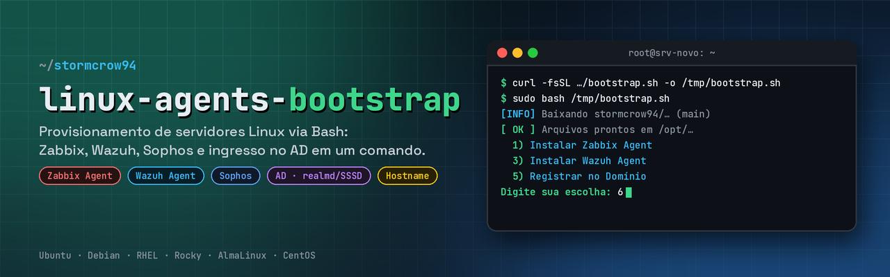

<p align="center">
  
</p>

<p align="center">
  
  
  
  
  
  <a href="https://github.com/stormcrow94/linux-agents-bootstrap/commits/main"></a>
</p>

# Shell Install Applications Script

Coleção de scripts Bash para **preparar servidores Linux recém-criados** com um único comando:
monitoramento (Zabbix Agent), segurança (Wazuh Agent e Sophos), ingresso no Active Directory
(realmd/SSSD) e configuração de hostname. Tudo pode ser executado por um **menu interativo**
(`installer.sh`) ou por **scripts individuais**, com logs por execução.

## Sumário

- [O que é instalado/configurado](#o-que-é-instaladoconfigurado)
- [Recursos](#recursos)
- [Compatibilidade](#compatibilidade)
- [Pré-requisitos](#pré-requisitos)
- [Início rápido](#início-rápido)
- [Uso](#uso)
- [Configuração](#configuração)
- [Logs e verificação](#logs-e-verificação)
- [Solução de problemas](#solução-de-problemas)
- [Segurança](#segurança)
- [Estrutura do projeto](#estrutura-do-projeto)
- [Documentação adicional](#documentação-adicional)
- [Contribuindo](#contribuindo)
- [Licença](#licença)

## O que é instalado/configurado

| Componente | Script | O que faz |
| --- | --- | --- |
| Zabbix Agent | `install_zabbix.sh` | Instala o agente pelo repositório oficial (`.deb`/`.rpm`) ou tarball estático, gera `zabbix_agentd.conf`, libera a porta no firewalld/UFW e habilita o serviço |
| Wazuh Agent | `install_wazuh.sh` | Baixa o pacote oficial na versão definida, registra no manager (`WAZUH_MANAGER`) e habilita o serviço |
| Sophos | `SophosSetup.sh` | Instalador oficial do Sophos Protection for Linux (gerado pelo Sophos Central) |
| Active Directory | `register_domain.sh` | Valida DNS/SRV, relógio e portas, faz `realm join`, configura SSSD, acesso por grupo (SSH) e sudo |
| Hostname | `hostname.sh` | Altera o hostname via `hostnamectl` e atualiza `/etc/hosts` (linha `127.0.1.1`) |
| Menu | `installer.sh` | Menu interativo que chama os scripts acima, inclusive em sequência (modo completo) |
| Bootstrap | `bootstrap.sh` | Baixa o repositório para `/opt/linux-agents-bootstrap` e abre o menu ou uma etapa |

## Recursos

- Menu interativo com detecção automática da distribuição, hostname e IP
- `bootstrap.sh` para instalar em servidor novo sem clonar o repositório
- Biblioteca compartilhada (`lib/common.sh`) com validação, logs, backup e gerência de pacotes (`apt`, `dnf`, `yum`)
- Configuração centralizada em `config/settings.conf`
- Zabbix em três modos (`auto`, `package`, `static`) com migração automática do binário estático para o pacote
- Registro no domínio idempotente e não interativo (variáveis de ambiente)
- Logs por execução em `logs/`

## Compatibilidade

| Componente | Distribuições | Observações |
| --- | --- | --- |
| Zabbix Agent | Ubuntu, Debian | Pacote oficial de `repo.zabbix.com` (modo `auto`/`package`); tarball estático só em `x86_64` |
| Zabbix Agent | RHEL, CentOS, Rocky, AlmaLinux 7–9 | RPM do repositório oficial (`x86_64`) |
| Wazuh Agent | Ubuntu, Debian / RHEL, CentOS, Rocky, AlmaLinux | Pacotes `amd64` (`.deb`) e `x86_64` (`.rpm`) |
| Domínio (AD) | Ubuntu 20.04/22.04/24.04, Debian 11/12, RHEL/Rocky/Alma 8/9 | Detecta `apt` ou `dnf`/`yum` |
| Sophos | Conforme requisitos do instalador oficial | 64 bits, systemd |
| Hostname | Qualquer distribuição com `hostnamectl` | — |

> A distribuição é identificada pelo `ID` de `/etc/os-release`. Derivados não listados (ex.: Linux Mint,
> Oracle Linux) são recusados pelos instaladores de Zabbix e Wazuh.

## Pré-requisitos

- Linux com **systemd**
- **Bash 4+**
- Acesso **root** (ou `sudo`)
- `curl` ou `wget` e `tar` (o bootstrap precisa de um deles para baixar o repositório)
- Saída para a internet (repositórios Zabbix/Wazuh/Sophos e GitHub)
- Para o domínio: DNS apontando para os controladores do AD e relógio sincronizado

## Início rápido

### Opção 1 — servidor novo, sem clonar (bootstrap)

```bash
curl -fsSL https://raw.githubusercontent.com/stormcrow94/linux-agents-bootstrap/main/bootstrap.sh -o /tmp/bootstrap.sh
less /tmp/bootstrap.sh          # revise antes de executar como root
sudo bash /tmp/bootstrap.sh     # abre o menu
```

Executar apenas uma etapa:

```bash
sudo bash /tmp/bootstrap.sh --domain     # ou --zabbix, --wazuh, --sophos, --hostname
```

| Opção | Descrição |
| --- | --- |
| *(sem argumento)* / `--menu` | Abre o menu do instalador |
| `--domain`, `--zabbix`, `--wazuh`, `--sophos`, `--hostname` | Executa somente a etapa escolhida |
| `--repo <owner/repo>` | Repositório alternativo (fork) |
| `--branch <nome>` | Branch alternativo (padrão: `main`) |
| `--dir <caminho>` | Destino (padrão: `/opt/linux-agents-bootstrap`) |
| `--keep-settings` | Preserva um `config/settings.conf` já ajustado no destino |
| `--download-only` | Apenas baixa os arquivos, sem executar nada |
| `-h`, `--help` | Ajuda |

> Sem `--keep-settings`, uma nova execução do bootstrap **sobrescreve** `config/settings.conf` no destino.

### Opção 2 — clonando o repositório

```bash
git clone https://github.com/stormcrow94/linux-agents-bootstrap.git
cd linux-agents-bootstrap
chmod +x *.sh lib/common.sh
sudo ./installer.sh
```

## Uso

### Menu principal (`installer.sh`)

| Opção | Ação |
| --- | --- |
| `1` | Instalar Zabbix Agent |
| `2` | Configurar Hostname |
| `3` | Instalar Wazuh Agent |
| `4` | Instalar Sophos |
| `5` | Registrar no Domínio |
| `6` | Executar Tudo (hostname → Zabbix → Wazuh → Sophos* → domínio*) |
| `7` | Editar configurações (`nano`, `vim` ou `vi`) |
| `8` | Ver logs |
| `0` | Sair |

\* No modo completo, Sophos e domínio pedem confirmação antes de executar.

### Scripts individuais

```bash
sudo ./install_zabbix.sh [IP_OU_HOST_ZABBIX]   # sobrescreve ZABBIX_PROXY_SERVER
sudo ./install_wazuh.sh  [WAZUH_MANAGER]       # sobrescreve WAZUH_MANAGER
sudo ./hostname.sh                             # pede o novo hostname
sudo ./register_domain.sh                      # interativo ou via variáveis (abaixo)
sudo ./SophosSetup.sh                          # instalador oficial Sophos
```

### Zabbix Agent: pacote oficial ou binário estático

Em Debian/Ubuntu o agente vem do repositório oficial (`repo.zabbix.com`) por padrão:

| `ZABBIX_INSTALL_MODE` | Comportamento |
| --- | --- |
| `auto` (padrão) | Tenta o pacote `.deb`; se o repositório falhar, instala o tarball estático |
| `package` | Somente pacote oficial (falha se o repositório não responder) |
| `static` | Somente tarball estático (comportamento antigo, `x86_64`) |

O pacote tem suporte a TLS/PSK e IPv6 e recebe correções de bibliotecas pelo `apt`. A configuração
gerada é a mesma nos dois modos (`Server`, `ServerActive`, `Hostname`, `HostMetadata`, `DebugLevel`,
`LogFileSize`). Ao migrar um host que estava no estático, o unit antigo é movido para
`/etc/systemd/system/zabbix-agent.service.bak.<data>` e o unit do pacote volta a ser usado.
Em RHEL/CentOS/Rocky/Alma é sempre usado o RPM oficial (`ZABBIX_RPM_BRANCH`).

### Registro no domínio (`register_domain.sh`)

Sem variáveis, o script pergunta domínio, usuário, senha, grupo e OU. Para uso não interativo:

```bash
sudo DOMAIN=empresa.local \
     ADMIN_USER=svc_join \
     ADMIN_PASS_FILE=/root/.adpass \
     ADMIN_GROUP=SUDOERS_NOMEDOSERVIDOR \
     COMPUTER_OU='OU=Computadores,DC=empresa,DC=local' \
     ./register_domain.sh
```

| Variável | Descrição | Padrão |
| --- | --- | --- |
| `DOMAIN` | Domínio AD | `DEFAULT_DOMAIN` |
| `ADMIN_USER` | Conta com permissão de ingresso | `DEFAULT_ADMIN_USER` |
| `ADMIN_PASS_FILE` | Arquivo com a senha na 1ª linha (modo `600`, apague após o uso) | — |
| `ADMIN_GROUP` | Grupo do AD com login SSH e sudo (validado no AD antes de aplicar) | `DEFAULT_ADMIN_GROUP` ou `SUDOERS_<HOSTNAME>` |
| `COMPUTER_OU` | OU da conta de computador | `CN=Computers` |
| `COMPUTER_NAME` | Nome NetBIOS (máx. 15 caracteres) | `DOMAIN_COMPUTER_NAME` ou hostname |
| `ACCESS_MODE` | `restricted` (só o grupo autentica) ou `permissive` (todo o domínio autentica) | `restricted` |
| `FORCE_REJOIN` | `1` sai e reingressa mesmo se o host já estiver no domínio | `0` |

O grupo recebe sudo em `/etc/sudoers.d/sudoers` (validado com `visudo`). O script é idempotente e
pode ser executado novamente. Mais detalhes em [PROJECT_DOCUMENTATION.md](PROJECT_DOCUMENTATION.md).

## Configuração

Edite `config/settings.conf` (ou use a opção `7` do menu). Principais parâmetros:

| Variável | Descrição | Padrão no repositório |
| --- | --- | --- |
| `ZABBIX_PROXY_SERVER` | IP/hostname do servidor ou proxy Zabbix | valor do ambiente do autor — **ajuste** |
| `ZABBIX_SERVER_PORT` / `ZABBIX_AGENT_PORT` | Portas do servidor e do agente | `10051` / `10050` |
| `ZABBIX_DEBUG_LEVEL` / `ZABBIX_LOG_SIZE` | Nível de debug (0–5) e tamanho do log (MB) | `3` / `10` |
| `ZABBIX_BRANCH` | major.minor do servidor Zabbix | `7.0` |
| `ZABBIX_INSTALL_MODE` | `auto`, `package` ou `static` (Debian/Ubuntu) | `auto` |
| `ZABBIX_AGENT_VERSION` | Versão do tarball estático (`latest` = último patch do branch) | `latest` |
| `ZABBIX_STATIC_AGENT_URL` | Override da URL do tarball estático | vazio |
| `ZABBIX_RPM_BRANCH` | Branch do repositório RPM (RHEL e derivados) | `7.0` |
| `WAZUH_MANAGER` | Endereço do Wazuh Manager | valor do ambiente do autor — **ajuste** |
| `WAZUH_VERSION` / `WAZUH_REVISION` | Versão e revisão do pacote | `4.14.0` / `1` |
| `DEFAULT_DOMAIN`, `DEFAULT_ADMIN_USER`, `DEFAULT_ADMIN_GROUP`, `DOMAIN_COMPUTER_NAME` | Padrões do registro no domínio | vazio |
| `CHECK_INTERNET` | Testa conectividade (`ping 8.8.8.8`) antes de instalar Zabbix/Wazuh | `true` |

`AUTO_BACKUP`, `NETWORK_TIMEOUT`, `EXECUTION_MODE`, `CONTINUE_ON_WARNING` e `VERBOSE_MODE` existem no
arquivo, mas ainda **não são lidos** pelos scripts (reservados).

## Logs e verificação

Cada execução grava um log em `logs/` dentro do diretório do projeto:

- `logs/installer_AAAAMMDD_HHMMSS.log` — menu, Zabbix, Wazuh e hostname
- `logs/register_domain_AAAAMMDD_HHMMSS.log` — registro no domínio

```bash
ls -lt logs/
tail -f "$(ls -t logs/*.log | head -n1)"
```

Validação pós-instalação:

```bash
systemctl status zabbix-agent
systemctl status wazuh-agent
realm list
id usuario@empresa.local
```

## Solução de problemas

| Sintoma | Causa provável / solução |
| --- | --- |
| "Sem conexão com a internet" com rede funcionando | A checagem usa ICMP (`ping 8.8.8.8`). Em redes que bloqueiam ICMP, defina `CHECK_INTERNET="false"` |
| `zabbix-agent` não sobe | `journalctl -u zabbix-agent -n 40 --no-pager` e o log em `logs/` |
| Tarball estático recusado | O binário estático é apenas `x86_64`; em outras arquiteturas use `ZABBIX_INSTALL_MODE=package` |
| "Distribuição não suportada" | O `ID` em `/etc/os-release` não está na lista de [compatibilidade](#compatibilidade) |
| `realm join` falha | Verifique DNS/SRV do domínio, relógio (Kerberos) e portas; conta já existente no AD → `FORCE_REJOIN=1` |
| Usuário do domínio não consegue logar | Confirme se pertence a `ADMIN_GROUP` (modo `restricted`) e rode `sss_cache -E` |

## Segurança

- Os scripts executam como **root** e alteram pacotes, serviços, firewall, SSSD e sudoers. Teste em
  homologação antes de usar em produção.
- Prefira baixar o `bootstrap.sh` para um arquivo e **revisá-lo** antes de executar, em vez de `curl | bash`.
- Nunca passe a senha do AD na linha de comando: use o prompt interativo ou `ADMIN_PASS_FILE` com
  `chmod 600`, e apague o arquivo depois.
- `config/settings.conf` contém endereços do ambiente (Zabbix/Wazuh). Em forks públicos, mantenha
  valores genéricos e use `--keep-settings` para preservar a configuração local.
- `SophosSetup.sh` é o instalador gerado pelo Sophos Central e é vinculado a um tenant. Use o
  instalador do **seu** Sophos Central. O uso é regido pelos termos da Sophos.

## Estrutura do projeto

```text
.
├── installer.sh            # Menu principal interativo
├── bootstrap.sh            # Instalação em um comando a partir do GitHub
├── install_zabbix.sh       # Zabbix Agent
├── install_wazuh.sh        # Wazuh Agent
├── register_domain.sh      # Ingresso no AD (realmd/SSSD)
├── hostname.sh             # Hostname
├── SophosSetup.sh          # Instalador oficial Sophos
├── fix_ssh_access.sh       # Placeholder (arquivo vazio)
├── lib/common.sh           # Funções compartilhadas
├── config/settings.conf    # Configuração centralizada
├── assets/                 # Banner e imagem de social preview
├── logs/                   # Gerado em tempo de execução (ignorado pelo Git)
├── .github/workflows/      # wiki-sync.yml: publica WIKI.md na Wiki do GitHub
└── *.md                    # Documentação
```

## Documentação adicional

- [PROJECT_DOCUMENTATION.md](PROJECT_DOCUMENTATION.md) — documentação técnica consolidada
- [WIKI.md](WIKI.md) — guia geral (sincronizado com a Wiki do GitHub)
- [QUICKSTART.md](QUICKSTART.md) — início rápido
- [QUICKSTART_WAZUH.md](QUICKSTART_WAZUH.md) — guia rápido do Wazuh
- [WAZUH_IMPLEMENTATION.md](WAZUH_IMPLEMENTATION.md) — detalhes da implementação do Wazuh
- [DEBIAN_GUIDE.md](DEBIAN_GUIDE.md) — orientações para Debian
- [EXAMPLES.md](EXAMPLES.md) — exemplos práticos
- [CONTRIBUTING.md](CONTRIBUTING.md) — como contribuir

## Contribuindo

Contribuições são bem-vindas. Veja [CONTRIBUTING.md](CONTRIBUTING.md).

## Licença

Este repositório ainda **não possui arquivo de licença**; sem ele, todos os direitos são reservados ao
autor. O `SophosSetup.sh` é software da Sophos Limited, sujeito aos
[termos de uso da Sophos](https://www.sophos.com/en-us/legal/sophos-end-user-terms-of-use).
